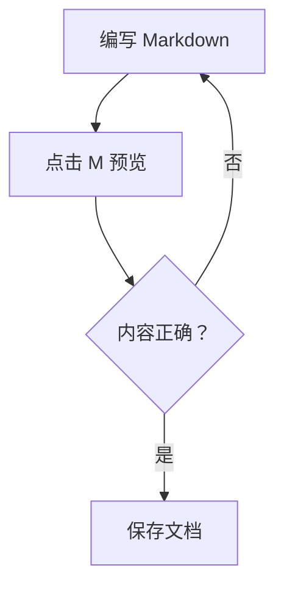
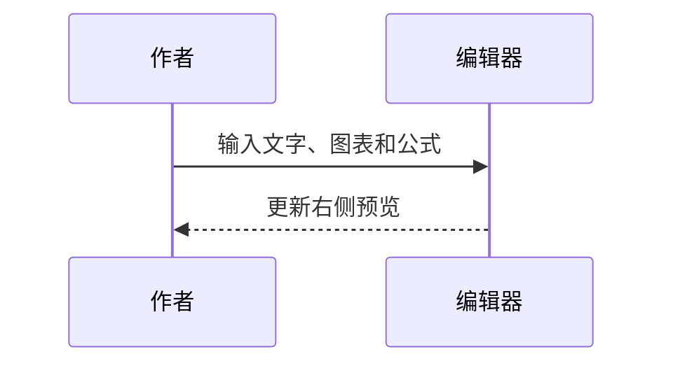

# Markdown 图表与公式

点击工具栏 **M** 打开预览，拖动中间分隔条调整预览宽度。

## 流程图

## 时序图

## 数学公式

行内公式：$E=mc^2$。

展示公式：

$$
\sum_{i=1}^{n} i = \frac{n(n+1)}{2}
$$

| 功能 | 用法 |
|---|---|
| 图表 | `mermaid` 代码块 |
| 行内公式 | 用一个美元符号包围公式 |
| 展示公式 | 用两个美元符号包围公式 |
